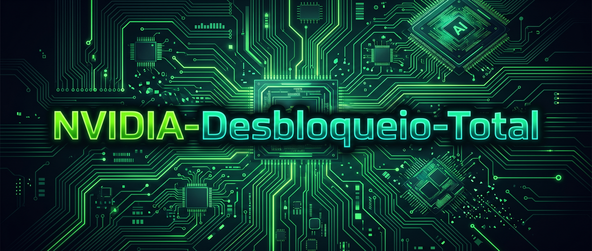

### Sua GeForce roda IA pela metade da velocidade. Isto resolve o problema.


**Até 2× de rendimento nos Tensor Cores para FP16 / BF16 / TF32** · **+25–55% em prefill de LLM** · **+25–50% em fine-tuning** · **+30–55% em geração de imagens**

[GPUs Suportadas](#gpus-suportadas) · [Benchmarks](#o-que-voce-ganha) · [Instalação](#como-instalar) · [FAQ](#faq) · [Como Funciona](#como-funciona)

---

A NVIDIA comercializa placas GeForce com os Tensor Cores limitados a **metade da velocidade** para cálculos matemáticos em FP16, BF16 e TF32 com acumulação em FP32 — que é exatamente o formato utilizado por quase todo o treinamento de inteligência artificial e inferência não quantizada. O mesmo chip de silício vendido como placa profissional da série RTX A opera em velocidade máxima. O `gpu_unlock` remove essa limitação durante o boot, antes que o driver original da NVIDIA seja carregado. Sem driver modificado, sem flash de VBIOS e sem precisar refazer nada quando a NVIDIA lança uma atualização de driver.

---

## GPUs Suportadas

| Geração | Placas | Status |
| :--- | :--- | :--- |
| **Ampere** (RTX 30) | RTX 3050, 3060, 3060 Ti, 3070, 3070 Ti, 3080, 3080 Ti, 3090, 3090 Ti, além de GPUs de notebook RTX 3070/3080 | Estável, 100+ relatos de usuários |
| **Ada Lovelace** (RTX 40) | RTX 4060, 4060 Ti, 4070, 4070 SUPER, 4070 Ti, 4070 Ti SUPER, 4080, 4080 SUPER, 4090, 4090 D, GPUs de notebook RTX 4050/4060 | Experimental |
| **Turing** (RTX 20) | RTX 2060, 2060 SUPER, 2070, 2070 SUPER, 2080, 2080 SUPER, 2080 Ti, Titan RTX | Experimental |
| **Blackwell** (RTX 50) | — | Não suportado |

Notebooks só permanecem desbloqueados se a GPU dedicada nunca for totalmente desligada. Muitos notebooks a desativam quando ociosa, o que reseta o desbloqueio silenciosamente. Desativar o gerenciamento de energia em tempo de execução com `options nvidia NVreg_DynamicPowerManagement=0x00` em `/etc/modprobe.d/` ajuda em alguns modelos, mas espere resultados mistos.

Os IDs exatos dos dispositivos PCI encontram-se em [`kernel/gpu_unlock/recipes.c`](kernel/gpu_unlock/recipes.c). Exclusivo para Linux. Para Windows, consulte o [FAQ](#faq).

---

## O que você ganha

A taxa dos Tensor Cores dobra. O ganho prático depende de quanto da sua carga de trabalho consiste em multiplicação de matrizes FP16/BF16/TF32 e se a placa possui margem de energia (power headroom) suficiente para executá-la.

Multiplicação de matrizes densas (acumulação em FP32, limites de energia padrão):

| Placa | BF16 antes | BF16 depois | Ganho |
| :--- | :--- | :--- | :--- |
| RTX 3060 12 GB | 27 TFLOPS | 51 TFLOPS | +87% |
| RTX 3060 Ti | 37 TFLOPS | 68 TFLOPS | +82% |
| RTX 3070 | 40 TFLOPS | 72 TFLOPS | +81% |
| RTX 3080 10 GB | 65 TFLOPS | 113 TFLOPS | +73% |
| RTX 3090 | 75 TFLOPS | 125 TFLOPS | +65% |
| RTX 3090 Ti (450 W) | 88 TFLOPS | 157 TFLOPS | +80% |
| RTX 4070 Ti | 81 TFLOPS | 150 TFLOPS | +84% |
| RTX 4080 | 104 TFLOPS | 193 TFLOPS | +87% |
| RTX 4090 | 165 TFLOPS | 329 TFLOPS | +100% (taxa MMA de pico) |

A RTX 4090 esgota o limite de energia antes de esgotar os Tensor Cores, portanto operações GEMM grandes com limites de energia padrão ganham muito menos do que a taxa de pico sugere.

Cargas de trabalho reais:

| Carga de Trabalho | Velocidade típica |
| :--- | :--- |
| Prefill de LLM / processamento de prompt, FP16/BF16 ou AWQ/GPTQ (vLLM, PyTorch, Transformers) | +25–55% |
| Tempo até o primeiro token (Time to first token) | 25–30% menor |
| Fine-tuning completo e LoRA em BF16 | +25–50% |
| Geração de imagens, FP16/BF16 (SDXL, SD 1.5, Krea, modelos DiT no ComfyUI) | +30–55% |
| Geração de vídeo, computação em BF16 (Wan 2.2) | +15–20% |
| Kernels FlashAttention / SDPA | +50–60% |
| llama.cpp / Ollama com GGUF quantizado | 0–15%, principalmente em contextos longos |
| Decodificação de LLM / geração de tokens (limitado por memória) | Sem alteração |
| Modelos INT8, FP8 e INT4 | Sem alteração |
| Jogos e CUDA em FP32 | Sem alteração |

As saídas permanecem idênticas a nível de bit antes e depois; apenas a velocidade muda. Esses números provêm dos [relatórios de compatibilidade](https://github.com/Zagitta/gpu-unlock/issues) enviados por usuários, onde você pode encontrar detalhes completos de benchmarks e publicar os seus próprios.

---

## Como instalar

Primeira execução:

```sh
git clone [https://github.com/Zagitta/gpu-unlock](https://github.com/Zagitta/gpu-unlock)
cd gpu-unlock
make install
Em seguida, adicione gpu_unlock.targets=all à linha de comando do seu kernel, preservando as opções existentes:

GRUB (Debian/Ubuntu/Mint): adicione o parâmetro dentro de GRUB_CMDLINE_LINUX_DEFAULT em /etc/default/grub, depois execute sudo update-grub.

GRUB (Arch/CachyOS): faça a mesma alteração e execute sudo grub-mkconfig -o /boot/grub/grub.cfg.

Fedora/RHEL: execute sudo grubby --update-kernel=ALL --args="gpu_unlock.targets=all".

systemd-boot: acrescente o parâmetro à linha options na sua entrada de boot (o comando bootctl status exibe a localização).

UKI / entradas geradas: adicione-o em /etc/kernel/cmdline e regenere suas imagens/entradas de boot (por exemplo, sudo mkinitcpio -P para UKIs do mkinitcpio).

FAQ
P: Você possui site, criptomoeda própria ou instalador automatizado?

R: Não, esta é a única e legítima fonte original do gpu-unlock. Criptomoedas, sites, instaladores ou quaisquer outras facilidades externas não possuem associação com este projeto ou com o desenvolvedor.

P: Isso depende de uma versão específica de driver? Vejo que o 610.43.03 está fixado.

R: Não, o driver é baixado apenas para extrair o firmware de que este desbloqueio necessita.

P: E quanto ao Windows?

R: Eu não utilizo o Windows e não pretendo dar suporte a ele, mas https://github.com/impacifist/Windows-GPU-UNLOCK criou uma adaptação — use por sua conta e risco. Existem instaladores para Windows circulando por aí, mas recomendo cautela extrema com eles.

P: E sobre a arquitetura Blackwell (RTX 50)?

R: Não é suportada e é improvável que venha a ser.

P: Por que a Nvidia limitou artificialmente a minha GPU?

R: Segmentação de mercado; o objetivo é direcionar empresas a comprarem as placas da linha profissional, que não possuem essas limitações, por preços significativamente mais altos.

P: Isso danifica a GPU?

R: É muito improvável. A ferramenta apenas libera uma pequena restrição imposta pela Nvidia para diferenciar linhas de data center e profissionais de versões voltadas ao consumidor. Pode elevar levemente a temperatura da placa por conta do aumento na capacidade de processamento, mas os mecanismos padrão de gerenciamento de energia e proteção térmica continuam totalmente intactos e realizarão o downclock se necessário.

P: Como posso ajudar?

R: Considere apoiar o projeto original para que o desenvolvedor possa adquirir mais GPUs <3.

Compilação Local
Cada compilação baixa os arquivos da NVIDIA/CachyOS via HTTPS e gera o firmware estritamente no diretório de build e no pacote binário. Os três formatos utilizam os mesmos alvos de instalação make install-*. Os pacotes são gerados a partir da árvore de trabalho, incluindo alterações não commitadas.

Compile, instale as dependências de compilação e instale os pacotes em uma única etapa (solicitará sua senha de sudo):

Bash
make install        # detecta a distribuição e seleciona um instalador compatível
make install-arch   # makepkg -sif
make install-deb    # apt-get build-dep, dpkg-buildpackage, apt-get install
make install-rpm    # dnf builddep, rpmbuild, dnf install
O comando make install utiliza /etc/os-release (ID e depois ID_LIKE) para identificar as famílias Arch, Debian/Ubuntu ou Fedora/RHEL/CentOS. O instalador RPM requer o DNF. Para outras distribuições, escolha um alvo explícito compatível listado acima.

Os comandos make arch, make deb e make rpm realizam apenas a compilação. Pacotes Debian e RPM são direcionados para build/deb e build/rpm. As entradas da NVIDIA ficam em cache em ~/.cache/gpu-unlock/inputs (make inputs; sobrescreva utilizando INPUTS=). O utilitário dpkg-buildpackage não faz uso de rede, portanto uma construção em chroot limpo (sbuild ou pbuilder) precisa do parâmetro GPU_UNLOCK_INPUTS apontando para esse cache. O arquivo compactado make dist, o pacote fonte Debian e o .nosrc.rpm não contêm arquivos da NVIDIA nem firmwares gerados.

Como Funciona
Este módulo de kernel para Linux combina a técnica V67/PLM do cmpunlocker com a abordagem de temporização pré-driver típica do método UEFI. No momento do boot, o sistema executa o desbloqueio, grava os seletores de velocidade (SS0 0x88888888, que seleciona a taxa completa em BF16, e o SS1 de 4 bits 0x8 IMLA4) e aplica um FLR (Function Level Reset) antes que o driver original da NVIDIA seja acoplado à placa. Trata-se de um módulo de kernel puro: não é um aplicativo UEFI nem um driver modificado da NVIDIA.

Fluxo de boot e ativação (Opt-in)
Os pacotes inserem o gpu_unlock e seu respectivo firmware dentro do initramfs, carregando-os antes que o módulo nvidia consiga vincular a placa:

mkinitcpio: /etc/mkinitcpio.conf.d/zz-gpu-unlock.conf insere o gpu_unlock imediatamente antes de nvidia no parâmetro MODULES, reduzindo ao máximo o tempo em que o monitor fica sem sinal. Caso o módulo nvidia não esteja presente na imagem, ele será posicionado por último, mas ainda assim executará antes de um driver nvidia carregado diretamente do sistema de arquivos raiz. As imagens são reconstruídas durante a instalação. O mkinitcpio ignora arquivos drop-in para imagens compiladas com a flag -c <config> ou com um preset _config; insira manualmente o gpu_unlock antes de nvidia no parâmetro MODULES dessa configuração.

initramfs-tools: /usr/share/initramfs-tools/modules.d/gpu-unlock.conf.

dracut: /usr/lib/dracut/dracut.conf.d/gpu-unlock.conf.

Com initramfs-tools e dracut, o módulo é compilado para todos os kernels instalados que possuem cabeçalhos, e as imagens desses kernels são reconstruídas na instalação e na desinstalação. Kernels instalados posteriormente recebem automaticamente o módulo e uma nova imagem através dos ganchos de instalação nativos do kernel.

Não existe regra softdep nvidia pre:: o kmod respeita exclusivamente a primeira linha softdep nvidia que lê; portanto, regras de outros pacotes (nvidia-utils, gddr6_hwmon) acabariam substituindo-a silenciosamente, ou vice-versa.

O módulo permanece inativo a menos que a linha de comando do kernel solicite a ativação:

gpu_unlock.targets=all                        # todas as placas compatíveis não vinculadas
gpu_unlock.targets=0000:21:00.0               # apenas estas placas específicas
gpu_unlock.targets=0000:21:00.0,0000:22:00.0    # múltiplos endereços separados por vírgula
Os endereços correspondem aos nomes PCI completos exibidos pelo comando lspci -D (com dígitos hexadecimais em maiúsculas ou minúsculas), de forma independente da numeração das GPUs ou da função de vídeo. Entradas que não correspondam a uma placa suportada (consulte GPUs Suportadas), incluindo o uso misto de all com endereços explícitos, geram logs de aviso e são ignoradas. O desbloqueio de múltiplas placas ocorre de forma concorrente (levando cerca de um segundo no total, independentemente da quantidade), sendo tratado individualmente para cada uma: placas já vinculadas ou desligadas são ignoradas. O barramento de controle que o firmware da placa manteve ativo (comportamento comum em placas Supermicro X11, independentemente das configurações de Option ROM e barramento) é limpo preliminarmente; placas já inicializadas por outro driver continuam sendo rejeitadas. Em seguida, o driver nvidia é carregado e vincula todas as placas normalmente.

A placa de vídeo principal utilizada para vídeo também funciona. O framebuffer do firmware (o console de boot e o Plymouth) continua em execução enquanto os passos de firmware do desbloqueio operam, sendo removido logo antes do reset da placa — o mesmo procedimento que o nvidia-drm faria momentos depois. A tela fica em branco desde esse reset até que o nvidia-drm assuma o controle.

Carregar o módulo manualmente após o boot não produz nenhum efeito em placas já vinculadas pelo driver nvidia.

A suspensão para a RAM (Suspend to RAM) desliga as placas, o que redefine os seletores de velocidade. Após o retorno da suspensão, o módulo desbloqueia novamente cada placa que havia sido destravada no boot, antes que o driver nvidia realize a retomada: a rotina de notificação de suspensão do módulo executa logo antes da rotina equivalente do driver nvidia (NVreg_UseKernelSuspendNotifiers=1, padrão nos drivers atuais; o serviço nvidia-resume.service roda mais tarde). Esse processo adiciona cerca de um segundo ao tempo de retomada. Placas que mantiveram energia (como no estado de suspensão para ocioso / suspend-to-idle) continuam desbloqueadas e passam apenas por leitura. Placas já retomadas pelo driver nvidia ou vinculadas a outro driver permanecem inalteradas, e o log registra o motivo. Adicione gpu_unlock.resume=0 à linha de comando do kernel, ou grave 0 em /sys/module/gpu_unlock/parameters/resume, para desativar esse comportamento. A hibernação não é contemplada.

Verifique o resultado executando:

Bash
journalctl -k -b | grep gpu_unlock
lspci -nnk -s 0000:[ID]:00.0
Para interromper o desbloqueio, remova o parâmetro gpu_unlock.targets= da linha de comando do kernel; para um boot pontual, remova-o na tela de edição do gerenciador de boot. A remoção dos pacotes também remove o módulo e os arquivos drop-in do initramfs.

Se o firmware de uma placa não interromper a execução, o módulo registrará a ocorrência no log e reterá os buffers de DMA que o firmware ainda possa utilizar até o próximo desligamento completo (power off). Desligue o sistema antes de tentar novamente.

O módulo de kernel e o empacotamento local são licenciados sob a GPL-2.0-only. O buffer gerado deriva da referência CMP fixada; o firmware da NVIDIA permanece sob seus próprios termos de licença. Consulte firmware/NOTICE.md e a pasta licenses/ para avisos e atribuições.
